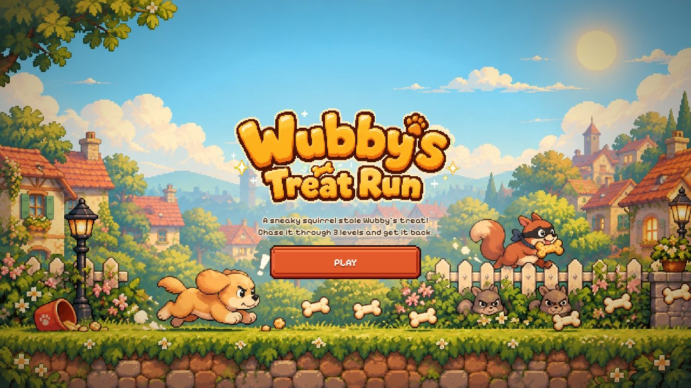

# 🐶 Wubby's Treat Run

A short pixel platformer for the browser. A sneaky squirrel stole Wubby's treat: chase it through three
hand-built levels, catch the thief, and take home a polaroid with your name on it.

**Play it: [play.devmehtaa.in](https://play.devmehtaa.in)**



## Controls

| | Keyboard | Touch |
|---|---|---|
| Move | ← → or A D | ◀ ▶ (bottom left) |
| Jump | Space, ↑ or W (hold for a higher jump) | JUMP (bottom right, hold for higher) |
| Pause | Esc or P | ⏸ (top right) |
| Sound on / off | M | 🔊 (top right) |
| Start | Enter or Space on the title | PLAY |

Portrait and landscape both work. Level 1 shows a short controls hint that fades once you've moved and jumped.

## Gameplay

- 3 levels of about 45–60 s each. Levels 1–2 end at a biscuit pedestal; level 3 ends with a chase.
- 3 hearts. A hit costs a heart and scatters up to 5 bones (grab them back within 3 s). Hazards and gaps send
  you to the last checkpoint; losing every heart restarts only the current level.
- 25–30 bones per level (every 25 = +1 heart, max 5; all of them = "full belly"). 3 hidden golden bones per level
  (all 9 = a gold-bordered polaroid).
- Squirrels: stomp from above. Hazards wear a red outline: red only ever means "this hurts".
- The game quietly helps if you keep falling in the same spot.

## Stack

- **Game:** vanilla JavaScript (classic scripts, no framework), HTML5 Canvas 2D with integer pixel scaling and a
  fixed 60 Hz physics step, Web Audio for the synthesized effects and the looping music.
- **Art pipeline:** Python (Pillow + NumPy) turns the source sheets in `assets/raw/` into atlases, lossless WebP and
  PNG fallbacks; `ffmpeg` makes the seamless music loop.
- **Build:** `scripts/build-dist.mjs` (esbuild): one minified script and stylesheet, content-hashed assets,
  WebP-first asset map.
- **Hosting:** Vercel (static site + two serverless functions in `api/`), Upstash Redis for the love counter and
  link-click counts.

## Run it locally

```bash
npm install
npm run dev        # serves the source at http://localhost:8000 (no build step needed)
npm run build      # production build into dist/
npm test           # syntax check + level checker
```

The `/api` routes only run on Vercel (`npx vercel dev` runs them locally with your env vars). Without them the game
works normally and the end screen shows a mock count of 128 on localhost.

### Environment variables (Vercel)

| Name | What |
|---|---|
| `UPSTASH_REDIS_REST_URL`, `UPSTASH_REDIS_REST_TOKEN` | Upstash Redis REST credentials. `KV_REST_API_URL` / `KV_REST_API_TOKEN` (set by the Vercel Marketplace integration) work too |
| `LOVE_HASH_SALT` | Random 32-byte secret that salts the IP hashes used for rate limiting. Without it nothing is counted |

See [.env.example](.env.example) and [SETUP.md](SETUP.md).

## Project layout

| Path | What |
|---|---|
| `index.html`, `style.css` | The page, HUD, menus and end screen |
| `config.js` | Every tunable: physics, hearts, bones, camera, creator links, production URL |
| `engine.js` | Pure logic: level parsing, collision, Wubby / squirrel / thief physics, jump arcs |
| `game.js` | Screens, game loop, asset loading, rendering, HUD, camera, touch controls |
| `art.js`, `audio.js` | Image loading (WebP with fallbacks) and sprite drawing; music and sound effects |
| `rewardCard.js`, `share.js`, `love.js` | The polaroid, copy-image, "Send Wubby some love" and the creator credit |
| `levels/` | Level tile maps ([how to edit them](levels/README.md)); `tools/check-levels.js` proves they're beatable |
| `api/` | Vercel functions: `GET/POST /api/love`, `POST /api/cta-click` |
| `public/assets/` | Built game art, audio and self-hosted fonts |
| `assets/raw/` | Art and music sources (kept in the repo, never deployed) |
| `scripts/` | `build_assets.py` (art + audio pipeline), `build-dist.mjs` (production build) |

## How it was built

Wubby started as a sprite sheet of a real dog and grew into a three-level game. The levels are plain-text tile
maps, checked by a script that simulates the exact jump arc and physics so every gap is fair. The art is generated
on green screen and keyed, sliced and packed by a Python pipeline; one rule drives the look: crisp, outlined and
saturated means interactive, soft and hazy means scenery. Audio is all code (Web Audio blips and jingles, measured
against the music bed) plus one music track cut to a seamless 24-phrase loop. The page loads only what the title
needs (about 375 KB) and streams the rest in while you read the story.

## Credits

See [CREDITS.md](CREDITS.md). Fonts: Pixelify Sans and Caveat (SIL Open Font License).
